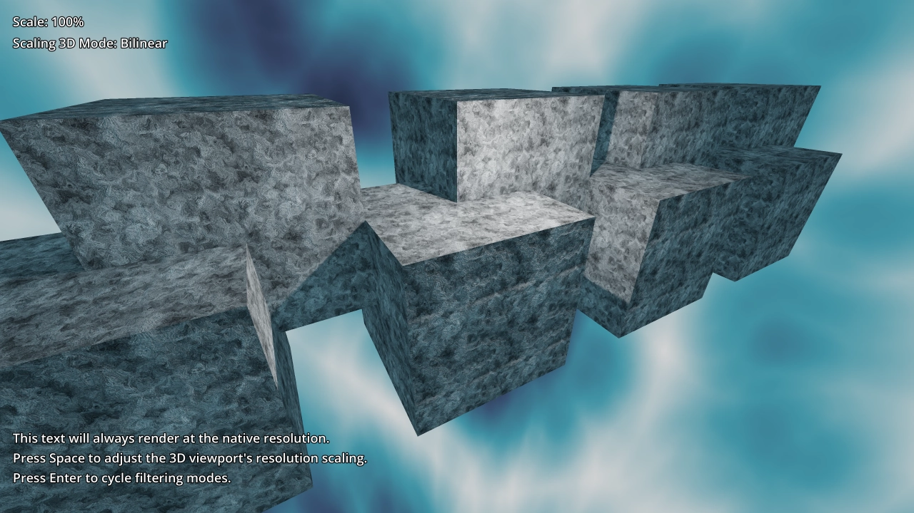
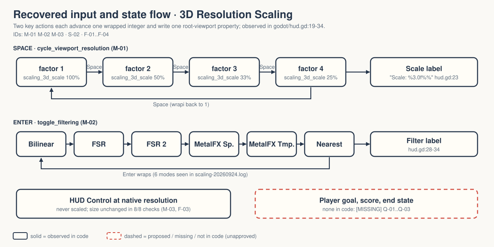

# walker-viewport-3d-scaling — Game Design Document (recovered)

| | |
|---|---|
| Version | 0.1.0-recovered |
| Date | 2026-09-27 |
| Author | Zelda (agent, `/gdd reverse --path godot silent`), for Nik Bear Brown |
| Mode | recovered, silent |
| Revision | 1 |
| Gates | gate — unsigned at time of writing (vision ○ · systems ○ · world ○ · scope ○) |
| Source | `godot/` — Walker title-only copy of Godot demo `viewport/3d_scaling`, commit `a3b5c113112f77291d5f3d1360f33a882fdc52f7` `[OBSERVED README.md:3-4]` |
| Engine | Godot 4.7.2 (logs), features "4.7"; no `rendering_method` set, so the project default applies; upstream README says Forward+ `[OBSERVED godot/project.godot:21,46-49; godot/README.md:11]` |

Provenance tags: `[OBSERVED path:line]` the code or a file in this folder says this · `[INFERRED]` the code strongly implies it; evidence stated · `[MISSING]` nothing here can tell you; logged in `decisions.md`. Paths are relative to the folder root. Dashed elements in diagrams and deck are not in the code.

**What this document is.** A description of what exists, recovered from code. It is not an approved design. This project is a rendering tech demo with two key presses, not a game.

*Upstream screenshot shipped with the Godot demo (`godot/screenshots/3d_scaling.webp`, referenced by `godot/README.md:17`). Not a Walker capture: GPU scaling quality and native-resolution HUD pixels are unverified in Walker `[OBSERVED README.md:10-12; FRICTIONAL.md:14-16]`.*

## 1. Vision summary

**What it is.** A 3D scene of eight textured cubes under a HUD. Space lowers the 3D render resolution (100% → 50% → 33% → 25% → 100%); Enter cycles the 3D scaling filter. The HUD text is meant to stay at native resolution throughout. `[OBSERVED godot/hud.gd:19-34; godot/hud.tscn:30-32]`

**What it demonstrates.** "Downscale the 3D resolution without affecting 2D elements, to improve performance without making the UI blurry." `[OBSERVED godot/README.md:3-4]` The performance half of that sentence is a claim of the upstream README; Walker has not measured it `[OBSERVED FRICTIONAL.md:14-15]`.

**Why it exists in Walker.** `[MISSING]` Only "independent title-only copy" and "both native-4K Liam films remain unverified" are on record `[OBSERVED README.md:3,10-12]`. Q-01.

**Player / audience.** `[MISSING]` There is a user who presses two keys, but no player goal. Implied audience: developers learning resolution scaling `[INFERRED from godot/README.md:6-7 docs link]`. Q-02.

**Fantasy, logline, promise.** Not applicable. `[MISSING]` by design.

## 2. Design pillars

`[MISSING]` None stated. Engineering properties the code protects, as inferences:

- **2D is never scaled.** HUD is a full-rect `Control`; only `root.scaling_3d_scale` changes `[INFERRED from godot/hud.gd:10,22; godot/hud.tscn:8-16]`. Walker's check confirms HUD dimensions do not change across all four factors `[OBSERVED scaling-20260924.log]`.
- **State is always labelled.** Each key press rewrites the matching label `[OBSERVED godot/hud.gd:23,28-34]`.

## 3. Core loop

**Micro.** Press Space or Enter → one integer state advances with wrap-around → the root viewport property is written → the label is rewritten. `[OBSERVED godot/hud.gd:19-34]` Nothing else changes: the camera is fixed, nothing moves `[OBSERVED godot/cubes.tscn:108-110; no _process in godot/hud.gd]`.

**Meso / macro.** None. There is no session, no end, no score. `[OBSERVED absence]`

**Loop honesty test.** Strip the cubes and the labels: the user toggles two numbers. As a demo, that is the whole point; as a game, there is nothing to decide. `[INFERRED]`

## 4. Player Experience Goals

`[MISSING]` None; no PX-xx IDs are assigned. A viewer goal ("a developer can see the 3D soften while the text stays crisp") is proposed in Q-02, not approved.

## 5. Mechanics

### M-01 Resolution factor cycle `[OBSERVED]`
Action `cycle_viewport_resolution` = Space (keycode 32) `[OBSERVED godot/project.godot:35-39]`. `scale_factor = wrapi(scale_factor + 1, 1, 5)`; `root.scaling_3d_scale = 1 / scale_factor`; label `"Scale: %3.0f%%"` `[OBSERVED godot/hud.gd:20-23]`. Values: 1, 2, 3, 4 → 100%, 50%, 33%, 25%. Tuning values, not approved design.

### M-02 Scaling-mode cycle `[OBSERVED]`
Action `toggle_filtering` = Enter (keycode 4194309) `[OBSERVED godot/project.godot:40-44]`. Cycles `Viewport.Scaling3DMode` from BILINEAR up to (not including) MAX `[OBSERVED godot/hud.gd:25-27]`. On this engine build the headless check saw six modes: Bilinear, FSR, FSR 2, Metalfx Spatial, Metalfx Temporal, Nearest `[OBSERVED scaling-20260924.log]`. The label builder capitalises "MetalFX" as "Metalfx" `[OBSERVED same log; godot/hud.gd:28-34]`: cosmetic, upstream, Q-09. Whether each mode actually renders on a given GPU is unverified `[OBSERVED FRICTIONAL.md:14-15]`.

### M-03 Native-resolution HUD `[OBSERVED]`
Help label (3 lines of instructions) and a two-label status box with 4 px black outlines `[OBSERVED godot/hud.tscn:20-51]`. Initial text "Scale: 100%" and "Scaling 3D Mode: Bilinear" `[OBSERVED godot/hud.tscn:45,51]`; `_ready` sets the mode to bilinear to match `[OBSERVED godot/hud.gd:15-16]`.

## 6. Systems

### S-01 Scene composition `[OBSERVED]`
`hud.tscn` (Control `HUD`, full rect, `hud.gd`) instances `cubes.tscn` (Node3D: WorldEnvironment with noise panorama sky, 8 `MeshInstance3D` 2×2×2 boxes sharing one noise-textured material with a noise normal map, Camera3D FOV 60, shadowed OmniLight3D) `[OBSERVED godot/hud.tscn:8-18; godot/cubes.tscn:3-116]`.

### S-02 Input map `[OBSERVED]`
Two actions, keyboard only, no gamepad events `[OBSERVED godot/project.godot:33-44]`.

### S-03 Render settings `[OBSERVED]`
Soft shadow filter quality 3; anisotropic filtering level 4; stretch `canvas_items` / `expand` `[OBSERVED godot/project.godot:28-31,46-49]`.

No collision layers, save/load or scene transitions `[OBSERVED absence]`.

## 7. Progression

Not applicable. `[MISSING]` by design.

## 8. World

One static arrangement of cubes under a procedural-noise sky. No world rules. `[OBSERVED godot/cubes.tscn]`

## 9. Narrative

None; none invented. `[MISSING]` by design.

## 10. Characters

None.

## 11. Features and priority

| ID | Feature | Status | Priority | Evidence |
|---|---|---|---|---|
| F-01 | 3D resolution factor cycle (Space) | implemented, headless-checked | CORE | 8 × 3 Space checks PASS |
| F-02 | 3D scaling-mode cycle (Enter) | implemented, headless-checked (state only) | CORE | 12 Enter cycles PASS |
| F-03 | HUD unaffected by 3D scale | implemented, headless-checked (dimensions only) | CORE | "HUD dimensions remain unchanged" ×8 |
| F-04 | Status labels mirror state | implemented, headless-checked | SUPPORTING | "scale label matches" ×8 |
| F-05 | Eight-cube test scene with noise materials and shadows | implemented | SUPPORTING | "eight cube mesh instances loaded" |
| F-06 | On-screen help text | implemented | SUPPORTING | `godot/hud.tscn:30-32` |
| F-07 | Headless diagnostic `test_scaling.gd` (Walker addition) | implemented, 37 assertions PASS | TOOLING | `scaling-20260924.log` |

**CORE: 3 of 7 = 43%**, over the 40% line. Recorded with both options in Q-07; tags unchanged.

## 12. Out of scope

Everything a game would need. Also: camera motion, performance readout (no FPS counter exists in code) `[OBSERVED absence in godot/hud.gd]`. The Walker copy changed the title only and made no font substitution `[OBSERVED FRICTIONAL.md:5-6]`.

## 13. Technical

- Scenes: `godot/hud.tscn` (main, `godot/project.godot:20`), `godot/cubes.tscn`. Scripts: `godot/hud.gd`, `godot/test_scaling.gd` (diagnostic). See `IMPLEMENTATION-MAP.md`.
- Assets: `noto_sans_ui_regular.ttf` (1 font), `icon.webp`; all materials are procedural noise in-scene. The font is not referenced by any scene, script or `project.godot` `[INFERRED from grep of godot/: only its .import file names it]`; Q-08.
- Licences: Godot MIT in `LICENSE.md`; SIL OFL 1.1 full text in `LICENSE.Noto.txt` for Noto Sans UI `[OBSERVED README.md:5-7]`.
- Verification on record: Godot 4.7.2 headless import and 120-frame runtime exit 0; `scaling-20260924.log` passes 37 assertions using real Space/Enter key events `[OBSERVED FRICTIONAL.md:8-12]`.
- Not verified: supported GPU modes, actual rendered resolution, filter quality, sharp HUD pixels, performance improvement `[OBSERVED FRICTIONAL.md:14-16]`.

## 14. Risks

| ID | Risk | Likelihood | Impact | Mitigation |
|---|---|---|---|---|
| R-01 | Stored property = rendered result is assumed | high | film or text claims FSR/MetalFX works where it silently falls back | Q-04; GPU capture per mode |
| R-02 | "Improves performance" repeated without a measurement | medium | unsupported claim in teaching material | Q-05 |
| R-03 | Unused font asset treated as used, or deleted without asking | low | licence clutter / lost attribution | Q-08; never delete without confirmation |
| R-04 | Project mistaken for a game | medium | invented goals | this document; Q-03 |

## 15. Open questions

In `decisions.md`: Q-01 purpose, Q-02 audience, Q-03 demo or game, Q-04 visual acceptance per mode, Q-05 performance claim, Q-06 film done, Q-07 CORE overage, Q-08 unreferenced font, Q-09 "Metalfx" label.

## 16. Tests

Existing `[OBSERVED godot/test_scaling.gd]`, 37 PASS in `scaling-20260924.log`:

| ID | Check |
|---|---|
| T-01 | Space ×8: factor 2,3,4,1,2,3,4,1 and `root.scaling_3d_scale == 1/factor` |
| T-02 | label text matches each factor |
| T-03 | HUD size unchanged at each factor |
| T-04 | Enter ×12: `filter_mode` cycles all six modes twice; requested = stored property |
| T-05 | eight cube meshes loaded |

Proposed (not written, not approved):

| ID | Check |
|---|---|
| T-06 | GPU capture at each factor × mode on the target machine; record which modes fall back (R-01) |
| T-07 | frame-time sample at 100% vs 25% on the same GPU (R-02) |
| H-01 | a person reads the help text at 25% scale and confirms it is crisp |

## Zelda's notes (silent mode; what I would have said out loud)

1. **Ghost Center — PRESENT, expected.** §1 "Why it exists in Walker" is `[MISSING]`.
2. **Mechanic Mirage — ABSENT by vacancy.** No PX goals.
3. **Implementation Void — PARTIAL.** The unhappy path for M-02 (a mode the GPU does not support) is undocumented in code and in the demo; the label will still claim the mode.
4. **Priority Inflation — PRESENT, harmless.** 43% CORE on a three-idea demo. Q-07.
5. **Novelist's Trap — ABSENT.**
6. **Completeness Fallacy — PRESENT.** The performance claim and the unused font were never questions until now (Q-05, Q-08).
7. **Stagnant Artifact — ABSENT.** Revision 1, CHANGELOG started.

**First fix:** Q-04. The demo's own label tells the viewer which mode is active; if that is not true on the capture machine, the film teaches the wrong thing.
